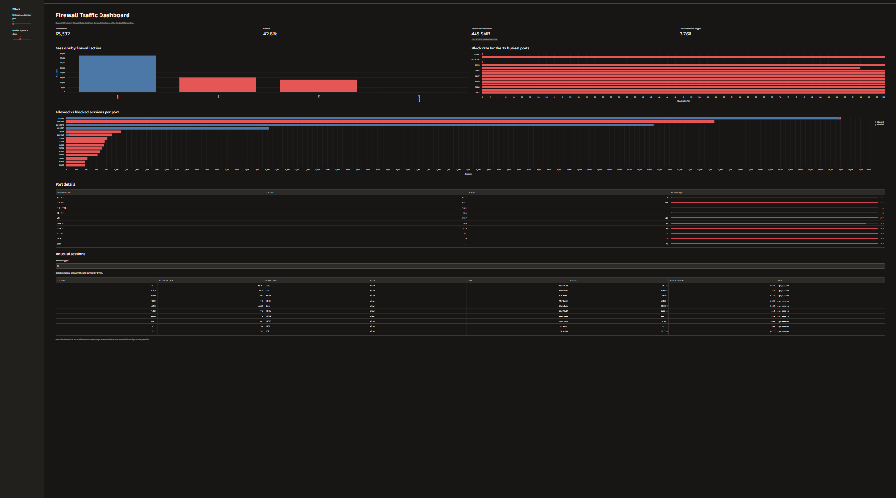

# Firewall Traffic Log Pipeline

A containerised SQL pipeline that loads a public firewall session dataset into PostgreSQL, cleans it, builds analytics tables, runs automated data quality checks, and serves a dashboard on top. It started as a pandas notebook and was rebuilt as a repeatable pipeline.

The analysis answers: how much traffic is allowed vs. blocked, which destination ports and services are blocked most, and which sessions look unusual.



## Architecture

```
log2.csv ──► raw.firewall_sessions ──► staging.firewall_sessions ──► analytics.* ──► Streamlit dashboard
 (CSV)        load_raw.py               02_staging.sql               03_analytics.sql   (read-only user)
                                        (types, flags, service names) (summary tables)
                                                    │
                                                    └─► data quality checks (transform.py)
```

| Layer | Table | Purpose |
|---|---|---|
| raw | `raw.firewall_sessions` | Untouched copy of the CSV with cleaned column names |
| staging | `staging.firewall_sessions` | Typed columns, `is_blocked` flag, readable `service_name` (445 → SMB, 22 → SSH) |
| staging | `staging.port_services` | Lookup table of well-known ports |
| analytics | `analytics.action_summary` | Allowed vs. blocked share, average bytes and packets per action |
| analytics | `analytics.block_rate_by_port` | Block rate per destination port (minimum 50 sessions) |
| analytics | `analytics.outlier_sessions` | Very large sessions (top 0.1% by bytes) and allowed sessions with no return traffic |

## Dashboard

A Streamlit app (`dashboard/app.py`) reads the `analytics` tables and shows headline numbers (total sessions, share blocked, top blocked destination, flagged sessions), sessions by action, block rate and allowed-vs-blocked counts for the busiest ports, and a filterable table of unusual sessions. Sidebar filters set the minimum sessions per port and how many ports to show. If the database is down, it shows how to start it instead of crashing.

## Data quality checks

`pipeline/transform.py` stops with an error if any of these fail:
- staging has the same row count as raw
- no null `destination_port` or `action`
- every action is one of `allow`, `deny`, `drop`, `reset-both`
- no negative bytes or packets
- every analytics table is non-empty

Each SQL file runs in a single transaction, and every table is dropped and rebuilt, so the pipeline can be re-run safely.

## Access control and query guardrails

The dashboard connects as a read-only database user (`sql/04_readonly_user.sql`) that can only `SELECT` from the `analytics` schema. It cannot read `raw` or `staging`, cannot write, and has a 5-second statement timeout.

`assistant/safe_sql.py` is a validator built so that SQL written by an LLM could be run safely later: it allows only a single `SELECT` on the analytics schema, rejects comments, multiple statements and system catalogs, and caps the number of rows returned. It is covered by 20 automated tests (`python -m pytest assistant`), and `assistant/demo_guardrails.py` shows the validator and the database permissions each blocking unsafe queries.

## Dataset

[Internet Firewall Data](https://archive.ics.uci.edu/dataset/542/internet+firewall+data) (UCI Machine Learning Repository, also on Kaggle). Download `log2.csv` and place it in `data/`.
Each row is a logged session with source/destination ports, action (allow, deny, drop, reset-both), bytes, packets and duration. The dataset has no IP addresses or timestamps.

## Questions answered

1. What share of sessions does the firewall allow vs. block, and by which action?
2. Which destination ports carry the most traffic, and which have the highest block rate?
3. How does traffic volume differ between allowed and blocked sessions?
4. Which sessions are outliers by size, and which allowed sessions are one-way?

## Key findings

- Of 65,532 sessions, 42.6% were blocked (deny 22.9%, drop 19.6%, reset-both 0.1%); 57.4% were allowed.
- SMB (port 445) was blocked 100% of the time and accounts for about 46% of all blocked sessions. Telnet (95.3%) and SSH (68.1%) were also heavily blocked, and VNC (port 5900) was blocked 93.9% of the time.
- Several of the busiest destination ports are high, non-standard port numbers that were blocked 100% of the time, a pattern consistent with scanning or probing.
- Blocked sessions were tiny (about 70-83 bytes, one packet on average), consistent with connection attempts. Allowed traffic is highly skewed: median 422 bytes, but the largest session was about 1.27 GB.

## How to run

Requires Docker, Python 3 and Git.

```bash
git clone https://github.com/Andy-2303/firewall-log-analysis.git
cd firewall-log-analysis
pip install -r requirements.txt

# download log2.csv into data/

docker compose up -d                        # start PostgreSQL
python pipeline/load_raw.py                 # load the CSV into raw.firewall_sessions
python pipeline/transform.py                # build staging + analytics tables and run checks
python -m streamlit run dashboard/app.py    # open the dashboard
```

You can also connect with any PostgreSQL client (for example DBeaver) and query the results:

- Host `localhost`, port `5432`, database `firewall`
- User `fw_user`, password `fw_pass` (local practice credentials defined in `docker-compose.yml`)

```sql
SELECT * FROM analytics.block_rate_by_port ORDER BY sessions DESC LIMIT 15;
```

`sql/01_first_queries.sql` has the first queries used to check the database against the original notebook. The original pandas analysis is still available in `firewall_log_analysis.ipynb`.

## Project structure

```
├── docker-compose.yml           PostgreSQL 16 container
├── requirements.txt
├── data/                        log2.csv goes here (not committed)
├── pipeline/
│   ├── load_raw.py              CSV -> raw table
│   └── transform.py             runs the SQL layers and the quality checks
├── sql/
│   ├── 01_first_queries.sql     validation queries
│   ├── 02_staging.sql           staging layer
│   ├── 03_analytics.sql         analytics layer
│   └── 04_readonly_user.sql     read-only database user
├── dashboard/
│   └── app.py                   Streamlit dashboard
├── assistant/                   SQL validator, tests and guardrail demo
├── docs/                        dashboard screenshot
└── firewall_log_analysis.ipynb  original exploratory analysis
```

## Tools

Python, pandas, SQLAlchemy, PostgreSQL 16, SQL, Docker Compose, Streamlit, Altair, pytest, Jupyter, matplotlib, seaborn

## Planned

- Natural-language question answering on top of the guardrails in `assistant/`
- Enrichment from an external API (for example service or IP reputation lookups)
- Scheduled runs with an orchestrator

## Limitations

No IP addresses or timestamps, so the analysis cannot cover source-based scanning or time-of-day patterns. Block rates for low-volume ports are filtered (minimum 50 sessions) to avoid misleading percentages. The database credentials are for local practice use only.
